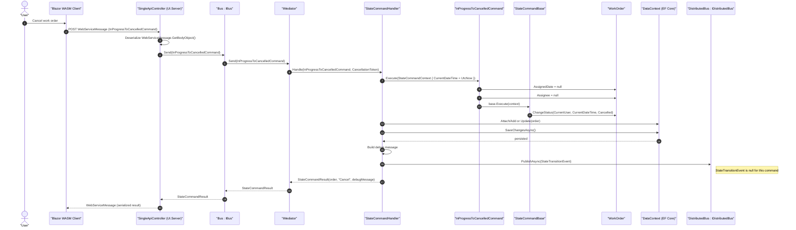

# InProgressToCancelledCommand Sequence Diagram

Note: Begin status: **InProgress**. End status: **Cancelled**. Allowed role: **Creator only** (CurrentUser == WorkOrder.Creator). Removes assignment when canceling.
