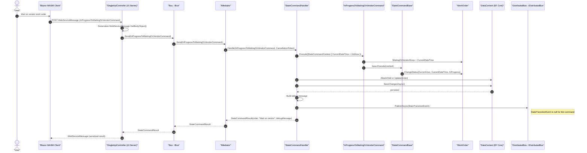

# InProgressToWaitingOnVendorCommand Sequence Diagram

Note: Begin status: **InProgress**. End status: **InProgress**. Allowed role: **Assignee only** (CurrentUser == WorkOrder.Assignee), and only while WorkOrder.WaitingOnVendorSince is null. The matching **Resume** command (WaitingOnVendorToInProgressCommand) clears WaitingOnVendorSince; leaving In Progress (Shelve, Complete, Cancel) also clears it.
