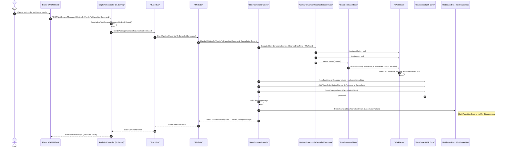

# WaitingOnVendorToCancelledCommand Sequence Diagram

Note: Begin status: **InProgress** (WaitingOnVendor substate). End status: **Cancelled**. Allowed role: **Creator only** (CurrentUser == WorkOrder.Creator). Guard: **WorkOrder.WaitingOnVendorSince != null**, in addition to the begin status and creator checks in StateCommandBase.IsValid(). Removes assignment (AssignedDate and Assignee) when canceling; WorkOrder.ChangeStatus also clears WaitingOnVendorSince when leaving InProgress.
