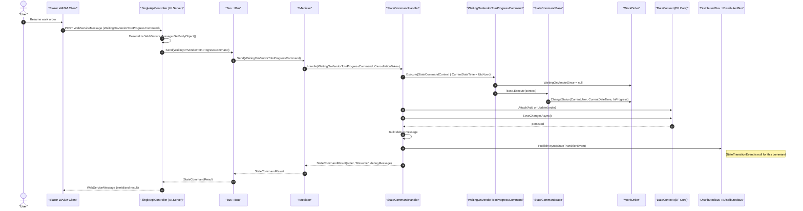

# WaitingOnVendorToInProgressCommand Sequence Diagram

Note: Begin status: **InProgress**. End status: **InProgress**. Allowed role: **Assignee only** (CurrentUser == WorkOrder.Assignee), and only when WorkOrder.WaitingOnVendorSince != null. This is the resume/unpause command paired with InProgressToWaitingOnVendorCommand.
