# C4 Architecture: Work Order System domain model

Icons: [Tabler](https://icones.js.org/collection/tabler) via [icones.js.org](https://icones.js.org/). [Register icon pack](https://mermaid.js.org/config/icons.html) to render (e.g. `@iconify-json/tabler`, name `tabler`).

The `.puml` is the class-diagram source for the checked-in PNG and SVG. The Mermaid overview below describes the same entities and supporting types, with representative state commands retained for context.

## Entities and supporting types

- **WorkOrder**: Number, Title, Description, Instructions, RoomNumber, optional Building (string), Priority, DueDate, Status, Creator/Assignee, AssignedDate, CreatedDate, CompletedDate, WaitingOnVendorSince, Attachments. Methods include `ChangeStatus()`, `CanReassign()`, `GetDueDateUrgency()` and `IsOverdue()`.
- **Employee**: UserName, FirstName, MiddleName (optional), LastName, EmailAddress, PreferredLanguage, Roles; create/fulfill permissions and full-name formatting.
- **Role**: Name, CanCreateWorkOrder, CanFulfillWorkOrder; roles may be shared by employees.
- **Team**: Name, Description (optional), Members, MemberCount; `AddMember()` maintains employee membership.
- **Vendor**: Name, Trade, ContactName, EmailAddress, PhoneNumber (optional contact fields), IsActive (defaults to true).
- **SavedSearchView**: Id, EmployeeId, Name, Query, CreatedDate; a named search owned by an employee.
- **WorkOrderStatusChange**: WorkOrderId, FromStatus, ToStatus, ChangedById/ChangedBy, ChangedDate; work-order status history.
- **WorkOrderAttachment**: Id, WorkOrderId, FileName, ContentType, FileSize, UploadedById/UploadedBy, UploadedDate; work-order attachment metadata.
- **EntityBase<T>**: Guid Id and identity equality; base for WorkOrder, Employee, Role, Team, Vendor and WorkOrderStatusChange. SavedSearchView and WorkOrderAttachment declare their own Id.
- **WorkOrderStatus**: Smart enum with None (empty sentinel), Draft, Assigned, InProgress, Complete and Cancelled, and Code, Key, FriendlyName and SortBy. WaitingOnVendor is an InProgress substate indicated by WaitingOnVendorSince, not a status value.
- **WorkOrderPriority**: enum Low = 1, Medium = 2 (default), High = 3; stored as tinyint.
- **DueDateUrgency**: non-persisted, read-time enum None = 0, DueToday = 1, Overdue = 2.

There is no Building entity: `WorkOrder.Building` is a nullable string. Team members are employees, not work-order assignments, and Vendor is an independent directory with no direct WorkOrder association. Status history and attachment metadata link to WorkOrder by WorkOrderId; ChangedBy and UploadedBy are optional employee navigations. WeatherForecast is a DTO; JSON converters, constants, messages, events and command/result records are not entities.

```mermaid
C4Component
  title Work Order System domain model

  Component(entityBase, "EntityBase<T>", "Abstract base class", "Id : Guid, equality by Id", "tabler:box")
  Component(workOrder, "WorkOrder", "Domain entity", "Aggregate root for work requests", "tabler:clipboard-list")
  Component(employee, "Employee", "Domain entity", "User profile and role membership", "tabler:user")
  Component(role, "Role", "Domain entity", "Authorization role with create/fulfill permissions", "tabler:shield")
  Component(team, "Team", "Domain entity", "Named group with employee membership", "tabler:users")
  Component(vendor, "Vendor", "Domain entity", "Independent vendor directory and contact details", "tabler:building-store")
  Component(savedSearchView, "SavedSearchView", "Domain entity", "Employee-owned named search query", "tabler:bookmark")
  Component(statusChange, "WorkOrderStatusChange", "Domain entity", "Status history with actor and date", "tabler:history")
  Component(attachment, "WorkOrderAttachment", "Domain entity", "Work-order attachment metadata and uploader", "tabler:paperclip")
  Component(workOrderStatus, "WorkOrderStatus", "Value object", "Smart enum: None, Draft, Assigned, InProgress, Complete, Cancelled", "tabler:circle-dot")
  Component(priority, "WorkOrderPriority", "Enum", "Low = 1, Medium = 2 (default), High = 3", "tabler:flag")
  Component(urgency, "DueDateUrgency", "Enum", "Read-time: None = 0, DueToday = 1, Overdue = 2", "tabler:calendar")
  Component(stateCommandBase, "StateCommandBase", "Abstract record", "Base for all state transition commands", "tabler:arrow-right")
  Component(saveDraft, "SaveDraftCommand", "State command", "Draft -> Draft (save)", "tabler:device-floppy")
  Component(draftToAssigned, "DraftToAssignedCommand", "State command", "Draft -> Assigned", "tabler:user-check")
  Component(assignedToInProgress, "AssignedToInProgressCommand", "State command", "Assigned -> InProgress", "tabler:player-play")
  Component(inProgressToComplete, "InProgressToCompleteCommand", "State command", "InProgress -> Complete", "tabler:circle-check")
  Component(stateCommandResult, "StateCommandResult", "Record", "Result of a state command execution", "tabler:clipboard-check")

  Rel(workOrder, entityBase, "inherits")
  Rel(employee, entityBase, "inherits")
  Rel(role, entityBase, "inherits")
  Rel(team, entityBase, "inherits")
  Rel(vendor, entityBase, "inherits")
  Rel(statusChange, entityBase, "inherits")

  Rel(workOrder, workOrderStatus, "status", "one shared status reference")
  Rel(workOrder, priority, "priority", "Medium by default")
  Rel(workOrder, urgency, "calculated urgency", "not persisted")
  Rel(workOrder, employee, "creator", "0..1 association")
  Rel(workOrder, employee, "assignee", "0..1 association")
  Rel(employee, role, "roles", "0..* shared membership")
  Rel(team, employee, "members", "0..* shared membership")
  Rel(savedSearchView, employee, "owner", "EmployeeId")
  Rel(workOrder, attachment, "attachments", "0..* composition; WorkOrderId")
  Rel(attachment, employee, "uploaded by", "UploadedById; optional navigation")
  Rel(workOrder, statusChange, "history", "0..*; WorkOrderId")
  Rel(statusChange, employee, "changed by", "ChangedById; optional navigation")
  Rel(statusChange, workOrderStatus, "from / to status")

  Rel(saveDraft, stateCommandBase, "extends")
  Rel(draftToAssigned, stateCommandBase, "extends")
  Rel(assignedToInProgress, stateCommandBase, "extends")
  Rel(inProgressToComplete, stateCommandBase, "extends")
  Rel(stateCommandBase, workOrder, "operates on")
  Rel(stateCommandBase, employee, "CurrentUser")
  Rel(stateCommandBase, workOrderStatus, "begin/end status")
  Rel(stateCommandResult, workOrder, "contains")
```

