# C4 Architecture: Component Diagram

This diagram shows all 15 projects in `src/ChurchBulletin.sln`: 12 non-test projects and the three test projects retained for context. Each of the 40 direct `ProjectReference` entries is represented by exactly one arrow from the referencing project to the referenced project; transitive dependencies are not added.

Core is the inner onion/domain layer. DataAccess, Database and LlmGateway are outer adapters; the UI projects, McpServer and Worker form the presentation/host layer. Aspire orchestration and shared operational defaults are shown separately, as are tests. The arrows show the actual project graph, not a new dependency policy. The SQL Server store is a runtime resource, not a solution project: its `DbUp` and `ConnectionString` arrows are not project references.

PlantUML is the source for the rendered assets: [source](arch-c4-component-project-dependencies.puml), [PNG](arch-c4-component-project-dependencies.png), [SVG](arch-c4-component-project-dependencies.svg). The Mermaid companion below mirrors the same project graph and layer groups.

Icons: [Tabler](https://icones.js.org/collection/tabler) via [icones.js.org](https://icones.js.org/). [Register icon pack](https://mermaid.js.org/config/icons.html) to render (e.g. `@iconify-json/tabler`, name `tabler`).

```mermaid
C4Component
  title Church Bulletin solution project dependencies

  ContainerDb(database, "Database", "SQL Server", "Transactional data store", "tabler:database")

  Container_Boundary(visualstudiosolution, "ChurchBulletin.sln") {
    Container_Boundary(domainLayer, "Inner onion: domain") {
      Component(core, "Core", "Class Library / net10.0", "Domain model, interfaces, queries", "tabler:package")
    }
    Container_Boundary(adapterLayer, "Outer onion: adapters") {
      Component(dataAccess, "DataAccess", "Class Library / net10.0", "EF Core DbContext, MediatR handlers, NServiceBus messaging", "tabler:database")
      Component(databaseProject, "Database", "Console App / net10.0", "DbUp schema migrations", "tabler:schema")
      Component(llmGateway, "LlmGateway", "Class Library / net10.0", "Azure OpenAI integration via Microsoft.Extensions.AI", "tabler:brain")
    }
    Container_Boundary(presentationLayer, "Outer onion: presentation and hosts") {
      Component(uiShared, "UI.Shared", "Razor Class Library / net10.0", "Shared Blazor pages and components", "tabler:layout")
      Component(uiApi, "UI.Api", "ASP.NET / net10.0", "API controllers and endpoint definitions", "tabler:api")
      Component(uiClient, "UI.Client", "Blazor WebAssembly / net10.0", "Interactive browser application", "tabler:app-window")
      Component(uiServer, "UI.Server", "ASP.NET / net10.0", "Hosts API, Blazor Server, MCP endpoint", "tabler:server")
      Component(mcpServer, "McpServer", "ASP.NET / net10.0", "Model Context Protocol tools for AI agents", "tabler:robot")
      Component(worker, "Worker", "Worker Service / net10.0", "NServiceBus endpoint for async processing", "tabler:settings-automation")
    }
    Container_Boundary(operationsLayer, "Operations and orchestration") {
      Component(serviceDefaults, "ChurchBulletin.ServiceDefaults", "Aspire Shared / net10.0", "OpenTelemetry and health check defaults", "tabler:adjustments")
      Component(appHost, "ChurchBulletin.AppHost", "Aspire AppHost / net10.0", "Orchestrates UI.Server and Worker", "tabler:rocket")
    }
    Container_Boundary(testLayer, "Tests") {
      Component(unitTests, "UnitTests", "NUnit / net10.0", "Tests all in-memory logic", "tabler:test-pipe")
      Component(integrationTests, "IntegrationTests", "NUnit / net10.0", "Tests logic across memory spaces", "tabler:test-pipe")
      Component(acceptanceTests, "AcceptanceTests", "Playwright + NUnit / net10.0", "End-to-end browser tests", "tabler:test-pipe")
    }
  }

  Rel(dataAccess, core, "Project Reference")
  Rel(llmGateway, core, "Project Reference")
  Rel(uiApi, core, "Project Reference")
  Rel(uiShared, core, "Project Reference")
  Rel(uiShared, llmGateway, "Project Reference")
  Rel(uiClient, core, "Project Reference")
  Rel(uiClient, uiShared, "Project Reference")
  Rel(uiServer, core, "Project Reference")
  Rel(uiServer, dataAccess, "Project Reference")
  Rel(uiServer, llmGateway, "Project Reference")
  Rel(uiServer, mcpServer, "Project Reference")
  Rel(uiServer, uiClient, "Project Reference")
  Rel(uiServer, uiApi, "Project Reference")
  Rel(uiServer, uiShared, "Project Reference")
  Rel(uiServer, serviceDefaults, "Project Reference")
  Rel(mcpServer, serviceDefaults, "Project Reference")
  Rel(mcpServer, core, "Project Reference")
  Rel(mcpServer, dataAccess, "Project Reference")
  Rel(mcpServer, llmGateway, "Project Reference")
  Rel(mcpServer, uiShared, "Project Reference")
  Rel(worker, dataAccess, "Project Reference")
  Rel(worker, llmGateway, "Project Reference")
  Rel(worker, serviceDefaults, "Project Reference")
  Rel(appHost, uiServer, "Project Reference")
  Rel(appHost, worker, "Project Reference")
  Rel(databaseProject, database, "DbUp")
  Rel(dataAccess, database, "ConnectionString")
  Rel(unitTests, core, "Project Reference")
  Rel(unitTests, serviceDefaults, "Project Reference")
  Rel(unitTests, databaseProject, "Project Reference")
  Rel(unitTests, mcpServer, "Project Reference")
  Rel(unitTests, worker, "Project Reference")
  Rel(unitTests, uiClient, "Project Reference")
  Rel(unitTests, uiApi, "Project Reference")
  Rel(unitTests, uiServer, "Project Reference")
  Rel(unitTests, uiShared, "Project Reference")
  Rel(integrationTests, uiServer, "Project Reference")
  Rel(integrationTests, mcpServer, "Project Reference")
  Rel(integrationTests, unitTests, "Project Reference")
  Rel(acceptanceTests, core, "Project Reference")
  Rel(acceptanceTests, integrationTests, "Project Reference")
  Rel(acceptanceTests, mcpServer, "Project Reference")
```

