# Church Bulletin DevOps Pipeline

This diagram models the delivery pipeline of this repository: the local quality gates, the Build workflow, the pull request checks, and the Release workflow that hands a release candidate to Octopus Deploy. Octopus Deploy and the Azure Container Apps environments are outside this repository and are not drawn here (see [Deployment](#deployment)).

## Source Files

| File | Purpose |
|------|---------|
| `build.ps1` | Build orchestration (Init, Compile, UnitTests, IntegrationTest, Package-Everything) |
| `BuildFunctions.ps1` | Helpers for `build.ps1`: database engine resolution (LocalDB, SQL container, SQLite), Docker and SQL Server setup |
| `PrivateBuild.ps1` | Local quality gate — runs `Build` (init, compile, unit tests, DB setup, integration tests), then the CRAP gate |
| `AcceptanceTests.ps1` | Local quality gate — runs `Invoke-AcceptanceTests` (Playwright) |
| `scripts/crap/run-crap-audit.ps1` | CRAP gate, run by `PrivateBuild.ps1` and by the `build-linux` job |
| `.github/workflows/build.yml` | CI workflow — triggers on all pushes: change detection, 8 gated jobs, `Build result`, publish to GitHub Packages |
| `.github/scripts/detect-code-changes.sh` | Docs-only classifier used by the `changes` job |
| `.github/workflows/secret-scan.yml` | gitleaks scan of the history of `HEAD` on pull requests and on pushes to master/main; a required check |
| `.github/workflows/render-diagrams.yml` | Pull request check for `arch/**`: re-renders the PlantUML diagrams and compares the SVGs |
| `.github/workflows/release.yml` | Release workflow — after a green Build of master: UI image to the container registry, database and acceptance-test packages to the Octopus built-in feed, Octopus release |
| `Dockerfile` | UI image: copies `built/` to `/app`, entry point `ClearMeasure.Bootcamp.UI.Server.dll` |
| `scripts/Write-BuildFacts.ps1` | Writes `build-facts.json` into the image folder (called by `release.yml`) |
| `codecov.yml` | States the required checks: `Build result` and `secret-scan` |
| `.github/copilot-code-review-instructions.md` | Copilot PR review rules |

## Pipeline Diagram

```mermaid
C4Deployment
  title Church Bulletin DevOps Pipeline
  UpdateLayoutConfig($c4ShapeInRow="3", $c4BoundaryInRow="1")

  Deployment_Node(local, "Developer Workstation", "Local machine") {
    Container(privatebuild, "PrivateBuild.ps1", "PowerShell", "Init, Compile, Unit Tests, DB Setup, Integration Tests, CRAP gate")
    Container(accepttests, "AcceptanceTests.ps1", "PowerShell + Playwright", "Init, Compile, DB Setup, Acceptance Tests")
  }

  Deployment_Node(github, "GitHub", "Source Control + CI/CD") {
    Deployment_Node(feature, "Feature Branch", "git push") {
      Deployment_Node(build_wf, "Build Workflow", "build.yml, on: push, all branches") {
        Container(changes, "Detect code changes", "bash", "Docs-only change sets skip the other jobs")
        Container(build_sql, "Integration Build (SQL Container)", "ubuntu-latest", "Build, CRAP gate, Package-Everything")
        Container(build_sqlite, "Integration Build (SQLite)", "ubuntu-latest", "Build -UseSqlite")
        Container(build_arm, "Integration Build (ARM SQLite)", "ubuntu-24.04-arm", "Build -UseSqlite")
        Container(build_win, "Integration Build (Windows LocalDB)", "windows-latest", "Build")
        Container(code_analysis, "Code Analysis", "dotnet format", "style, analyzers, EnforceCodeStyleInBuild")
        Container(qodana, "Qodana (Community .NET)", "JetBrains Qodana", "Committed baseline, fail threshold 0")
        Container(ci_cache, "CI Cache", "actions/cache", "NuGet packages, Playwright browsers")
        Container(at_x86, "Acceptance Tests", "ubuntu-latest, Playwright", "Invoke-AcceptanceTests, SQL container")
        Container(at_arm, "Acceptance Tests (ARM SQLite)", "ubuntu-24.04-arm, Playwright", "Invoke-AcceptanceTests -UseSqlite")
        Container(gh_packages, "Publish to GitHub Packages", "nuget.pkg.github.com", "needs: build-linux, publish NuGet packages")
        Container(build_result, "Build result", "bash", "Fails unless every gated job succeeded")
      }
    }

    Deployment_Node(pr, "Pull Request", "Required checks") {
      Container(render_check, "Render diagrams (check)", "render-diagrams.yml", "pull_request touching arch/**")
      Container(secret_scan, "secret-scan", "secret-scan.yml, gitleaks", "pull_request and push to master / main")
      Container(checks, "Pull Request Checks", "GitHub ruleset", "required: Build result and secret-scan")
      Container(copilot_review, "Copilot Code Review", "GitHub Copilot", "Architecture, Security, Testing, Naming, Dependencies")
      Container(human_review, "Human Reviewer", "GitHub PR Review", "Manual approval")
    }

    Deployment_Node(master, "master branch", "merge trigger") {
      Container(master_build, "Build Workflow (master)", "GitHub Actions", "Same jobs, queued instead of cancelled")
    }

    Deployment_Node(release_wf, "Release Workflow", "release.yml, workflow_run trigger") {
      Container(rel_image, "Build and push the UI image", "docker, az acr", "UI package contents plus build-facts.json, image tag write-locked")
      Container(rel_octopus, "Push packages, create the release", "Octopus actions", "Database and acceptance-test packages to the built-in feed")
    }
  }

  System_Ext(octopus, "Octopus Deploy (cmdemo1 demo space) and Azure Container Apps tdd / uat / prod", "Not drawn here: the platform's health dashboard draws the deployed runtime")

  Rel(privatebuild, changes, "git push", "feature branch")
  Rel(build_sql, gh_packages, "needs", "build-linux")
  Rel(build_result, checks, "required check", "Build result")
  Rel(secret_scan, checks, "required check", "secret-scan")
  Rel(render_check, checks, "check", "arch/** only")
  Rel(checks, copilot_review, "then")
  Rel(copilot_review, human_review, "then")
  Rel(human_review, master_build, "merge", "approved PR")
  Rel(master_build, rel_image, "workflow_run", "Build completed, success, master")
  Rel(rel_image, rel_octopus, "then")
  Rel(rel_octopus, octopus, "release", "MAJOR.MINOR.run_number")
```



## Pipeline Stages

| # | Stage | Trigger | Tool | Key Steps |
|---|-------|---------|------|-----------|
| 1 | **Private Build** | Manual (`PrivateBuild.ps1`) | PowerShell + .NET CLI | Clean, Compile, Unit Tests, DB Migrate, Integration Tests, CRAP gate |
| 2 | **Acceptance Tests** | Manual (`AcceptanceTests.ps1`) | PowerShell + Playwright | Compile, DB Setup, Playwright browser tests |
| 3 | **Change Detection** | `git push` (all branches) | GitHub Actions | `changes` job: a docs-only change set skips the heavy jobs; detection fails open |
| 4 | **Integration Build** | `git push` (all branches) | GitHub Actions | 4 variants (SQL container, SQLite, ARM SQLite, Windows LocalDB); the SQL container job also runs the CRAP gate and packages everything |
| 5 | **Code Analysis** | `git push` (all branches) | GitHub Actions | `dotnet format style`, `dotnet format analyzers`, `EnforceCodeStyleInBuild` |
| 6 | **Qodana** | `git push` (all branches) | GitHub Actions | Qodana (Community .NET) against the committed baseline `qodana.sarif.json`, fail threshold 0 |
| 7 | **Acceptance Tests (CI)** | `git push` (all branches) | GitHub Actions | Playwright tests on x86 (SQL container) and ARM (SQLite) |
| 8 | **Publish** | After build-linux succeeds | GitHub Actions | NuGet → GitHub Packages |
| 9 | **Build result** | After the gated jobs | GitHub Actions | Aggregates the gated jobs; a required check |
| 10 | **Secret Scan** | Pull request, push to master/main | GitHub Actions | gitleaks over the history of `HEAD`; a required check |
| 11 | **Render diagrams (check)** | Pull request touching `arch/**` | GitHub Actions | Re-renders every `arch/**/*.puml` with `plantuml/plantuml:1.2026.2` and compares the normalized SVGs |
| 12 | **PR Review** | PR opened | Copilot + Human | Architecture, security, testing standards, dependency review |
| 13 | **Release** | Build of master completed successfully (push or started by hand) | GitHub Actions (`release.yml`) | Find the build's packages, build and push the UI image (tag write-locked), push the database and acceptance-test packages to the Octopus built-in feed, create the Octopus release |
| 14 | **Deploy** | Octopus lifecycle | Octopus Deploy (outside this repository) | Deploys the release to the first environment; deployments, approvals and the GitOps pin are Octopus's |

The `security-scan` job in `build.yml` (NuGet vulnerabilities, Gitleaks, credential files, code patterns) is defined but disabled with `if: false`; secrets are scanned by `secret-scan.yml`.

## Build Function Call Graph

```
PrivateBuild.ps1 → Build(), then the CRAP gate (scripts/crap/run-crap-audit.ps1)
                      ├── Init()           — clean, restore
                      ├── Compile()        — dotnet build (warnings-as-errors)
                      ├── UnitTests()      — dotnet test (NUnit + code coverage)
                      ├── Setup-DatabaseForBuild()
                      │     ├── SQL-Container: Docker + migrate
                      │     └── LocalDB: integrated auth + migrate
                      └── IntegrationTest() — dotnet test

AcceptanceTests.ps1 → Invoke-AcceptanceTests()
                        ├── Init()
                        ├── Compile()
                        ├── Setup-DatabaseForBuild()
                        └── AcceptanceTests() — Playwright

CI Build (build.yml, job build-linux) → Build() + Package-Everything()
                                    ├── PackageUI()              → ChurchBulletin.UI.nupkg
                                    ├── PackageDatabase()        → ChurchBulletin.Database.nupkg
                                    ├── PackageAcceptanceTests() → ChurchBulletin.AcceptanceTests.nupkg
                                    └── PackageScript()          → ChurchBulletin.Script.nupkg
```

## Release Workflow

`release.yml` replaces the upstream bootcamp's `deploy.yml` and the publish jobs of `build.yml`. It runs after a successful Build of master (a push, or a Build started by hand) and turns that build's packages into a release candidate:

| Step | Name | Description |
|------|------|-------------|
| 1 | Find the build's packages (`packages` job) | Looks for the `churchbulletin-nuget-packages` artifact of the Build run; a docs-only change set skips the heavy jobs and has none |
| 2 | Version | `MAJOR_VERSION.MINOR_VERSION` from `build.yml` plus the Build run number |
| 3 | Download and extract | Downloads the build's packages and extracts `ChurchBulletin.UI.*.nupkg` into `built/` |
| 4 | Stamp the build facts | `scripts/Write-BuildFacts.ps1` writes `built/build-facts.json`, which the app serves at `/_build` |
| 5 | Build and push the image | Azure login by OIDC, `docker build --file Dockerfile`, push to `ACR_LOGIN_SERVER/SYSTEM_SLUG/DEPLOYABLE_NAME:version`, then lock the tag (write and delete disabled) |
| 6 | Trim the acceptance-test package | Keeps the Playwright driver for linux-x64 only |
| 7 | Push the database and acceptance-test packages | `OctopusDeploy/push-package-action` to the Octopus built-in feed |
| 8 | Create the release | `OctopusDeploy/create-release-action`: project `SYSTEM_SLUG-DEPLOYABLE_NAME`, release number = version |

## Deployment

Octopus Deploy and the Azure Container Apps environments (tdd, uat, prod) are not defined or drawn in this repository: there is no `.octopus` folder and no `deploy.yml`. After the Release workflow creates the release, its lifecycle in Octopus deploys it to the first environment. Deployments, approvals and the GitOps pin are Octopus's.

The platform's health dashboard draws the deployed runtime (resource groups, container apps, registry, Octopus): <https://blue-bush-041023510.1.azurestaticapps.net/#runtime/prod> (also `#runtime/tdd` and `#runtime/uat`).

## Key Design Principles

- **One Version per Build** — `MAJOR.MINOR.run_number` is stamped into the packages by `build.yml` and reused by `release.yml` as the image tag and the Octopus release number
- **Immutable Artifacts** — A released image tag is write-locked; packages are pushed with `--skip-duplicate` (GitHub Packages) and `IgnoreIfExists` (Octopus)
- **Approval Gates** — Deployments, approvals and the GitOps pin belong to Octopus; the Release workflow authenticates with GitHub OIDC only (environment `release`)
- **Required Checks** — `Build result` and `secret-scan` (see `codecov.yml` and the header of `secret-scan.yml`)
- **Copilot Code Review** — Architectural and standards rules in `.github/copilot-code-review-instructions.md` apply to every PR
- **Docs-only Skip** — The `changes` job skips the heavy Build jobs for docs-only change sets (allowlist) and fails open when unsure
- **Concurrency Control** — Build jobs are cancelled on new commits except on master, where they queue; releases queue instead of cancelling
