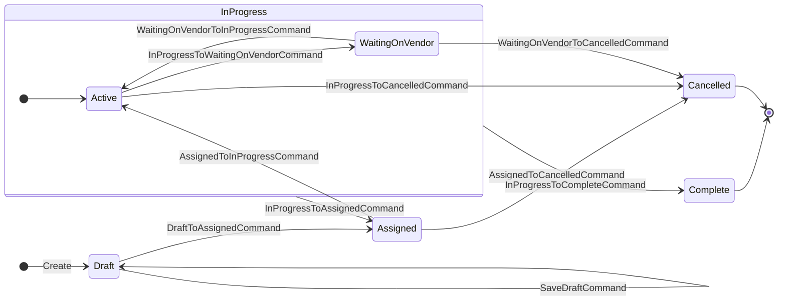

# Work Order State Transitions

The persisted statuses are Draft, Assigned, InProgress, Complete and Cancelled.
WaitingOnVendor is a substate of InProgress, not a separate status: active work
has a null `WaitingOnVendorSince`, while vendor waiting has a non-null value.
Command-labelled arrows correspond to the implementations in
`src/Core/Model/StateCommands/`.

Completion and shelving (the return to Assigned) apply to either InProgress
substate. Cancellation is available from Assigned and from each InProgress
substate through its corresponding command, but not from Draft or Complete.
Leaving InProgress clears `WaitingOnVendorSince`; re-entering starts active work.
Complete and Cancelled are terminal states.

The matching PlantUML source is [arch-state-workorder.puml](arch-state-workorder.puml),
with generated [PNG](arch-state-workorder.png) and [SVG](arch-state-workorder.svg) images.
