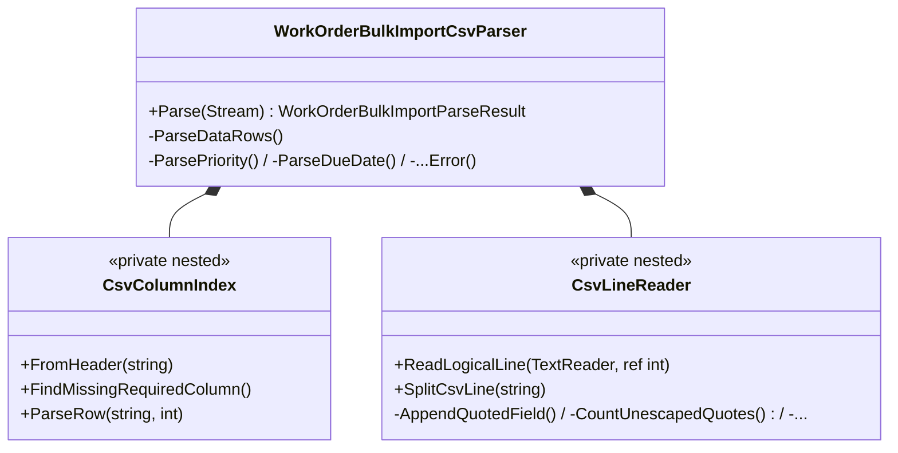
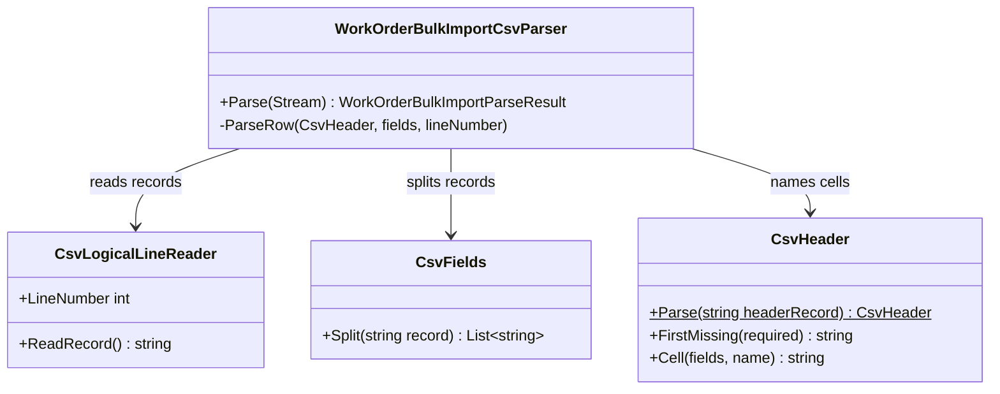

# Refactoring oversized code

The size gate (#1536, `src/UnitTests/BuildGates/SizeAndNesting*`) flags production files over 300 lines, test files
over 600 lines, methods over 30 lines, more than 4 parameters (positional record parameters included) and nesting
deeper than 3. When it flags code, the fix is a **refactoring that
surfaces the abstraction trying to emerge**, never a mechanical split. This codebase teaches a class: every refactor
should read like a worked example.

Sources: Fowler, *Refactoring* (2nd ed.); Evans, *Domain-Driven Design*; Kerievsky, *Refactoring to Patterns*;
Martin, *Clean Code*.

**Guided, not strict.** The moves below are preferred. Any other move is allowed when the pull request gives a
written reason (write `Other: <move>` in the rationale row). Banned moves are never allowed.

## Workflow

1. Read the gate message: it names the file and the limit it breaks.
2. **Diagnose** (below): name the smells and the domain concept trying to emerge. If no concept can be named, the code
   is not understood well enough to move yet.
3. Pin the behavior with tests first (characterization tests) when coverage is thin.
4. Apply one preferred move at a time, building and testing after each step.
5. Give every extracted class its own test fixture (`<ClassName>Tests`), written to the test rules below.
6. Delete the fixed lines from `src/UnitTests/BuildGates/size-nesting-baseline.txt`; baselines only shrink.
7. Fill in the **Refactoring plan** section of the pull request template: one rationale row per move, a Before and an
   After mermaid diagram per concept cluster, and the generated line-count table (below).

## Diagnose first

### Smells

| Smell | Signals in this codebase |
|-------|--------------------------|
| Large Class | A page, tool class or handler over the file limit; fields used by only some methods |
| Long Method | A method over the method limit; comments or blank lines separating "steps" |
| Long Parameter List | More than 4 parameters, often MCP tool methods or private helpers threading state |
| Divergent Change | One class edited for unrelated reasons (validation, persistence, formatting) |
| Shotgun Surgery | One rule (for example "open work order") repeated across handlers, pages and tools |
| Feature Envy | UI or MCP code reaching into `WorkOrder` fields to decide what the domain should decide |
| Data Clumps | The same 3+ values passed together (`building`, `room`, `dueDate`, ...) |
| Primitive Obsession | Strings and ints standing in for domain ideas (status codes, numbers, date ranges) |
| Switch Statements | `switch`/`if` chains on a type code or status, repeated in several places |
| Deep Nesting | Nesting deeper than 3: loops in conditions in `try` blocks |
| Duplicated Code | The same block in two files, or a test pasted with one value changed |

### The concept trying to emerge

Ask what a domain expert would call the extracted thing, and use that **ubiquitous-language** name. Then decide
which building block it is:

| Building block | Meaning | Lives in |
|----------------|---------|----------|
| Entity | Identity that persists through change (`WorkOrder`, `Employee`) | `src/Core/Model/` |
| Value object | Immutable, compared by value, validates itself (a date range, a work-order number) | `src/Core/Model/` |
| Aggregate | A consistency boundary changed only through its root | `src/Core/Model/` |
| Domain service | Domain logic that belongs to no single entity (`DueDateUrgencyCalculator`) | `src/Core/Services/` |
| Specification | A named, combinable predicate (`WorkOrderSpecificationQuery`) | `src/Core/Queries/` |
| Query / command + handler | An application operation sent through `IBus` | `src/Core/Queries/`, `src/DataAccess/Handlers/` |
| Blazor child component | A coherent piece of a page with its own parameters and events | `src/UI.Shared/Components/` |

## Preferred moves

| Refactoring | Fixes | Source | In this codebase |
|-------------|-------|--------|------------------|
| Extract Class | Large Class, Divergent Change | Fowler | Split a tool class by concept: one class per responsibility, named for it |
| Move Function (Move Method) | Feature Envy, Shotgun Surgery | Fowler | Move a decision about a work order onto `WorkOrder` |
| Move Field | Feature Envy, Data Clumps | Fowler | Move state next to the behavior that uses it |
| Extract Function (Extract Method) | Long Method | Fowler | Name each step of a long method after what it does |
| Compose Method | Long Method | Kerievsky | Make a method read as a list of same-level steps |
| Replace Function with Command (Replace Method with Method Object) | Long Method, Long Parameter List | Fowler, Kerievsky | Turn a long handler body with many locals into a class whose fields are those locals |
| Split Phase | Long Method, Divergent Change | Fowler | Separate parse, validate and execute (CSV import, MCP tools) |
| Introduce Parameter Object | Long Parameter List, Data Clumps | Fowler | A record for values that always travel together |
| Preserve Whole Object | Long Parameter List | Fowler | Pass the `WorkOrder`, not five of its fields |
| Replace Primitive with Object (Value Object) | Primitive Obsession | Fowler, Evans | A Core value object that validates itself |
| Replace Conditional with Polymorphism | Switch Statements | Fowler | One subclass or implementation per case |
| Replace Conditional Logic with Strategy | Switch Statements | Kerievsky | One strategy per algorithm, chosen once |
| Replace State-Altering Conditionals with State | Switch Statements | Kerievsky | The state-command pattern already used for work-order status |
| Replace Nested Conditional with Guard Clauses | Deep Nesting | Fowler | Return early for the unusual cases |
| Decompose Conditional | Deep Nesting, Long Method | Fowler | Name the condition and each branch |
| Extract Superclass | Duplicated Code | Fowler | Shared behavior of sibling classes |
| Extract Subclass | Large Class, Switch Statements | Fowler | Behavior used by only some instances |
| Replace Implicit Tree with Composite | Large Class, Duplicated Code | Kerievsky | Nested structures built by hand (report sections, menus) |
| Extract Query or Command | Large Class, Feature Envy | Codebase | Data work in a page or tool becomes a MediatR request and handler |
| Extract Domain Object | Feature Envy, Primitive Obsession | Codebase | Logic in UI, MCP or DataAccess moves into an entity or value object in Core |
| Extract Blazor Component | Large Class, Long Method | Codebase | A section of a `.razor` page becomes a child component with parameters and events |
| Introduce Specification | Switch Statements, Duplicated Code, Shotgun Surgery | Codebase | A named predicate reused by search, summary and reports |

## Banned moves

| Banned move | Why | Enforced by |
|-------------|-----|-------------|
| `partial` types to get under a limit | Same class, more files: the smell is hidden, not fixed | `PartialTypeRule` |
| Extension methods on our own types in a separate file | Moves behavior away from the type it belongs to (Feature Envy in disguise) | `OwnTypeExtensionRule` |
| Static `*Helper(s)` / `*Util(s)` / `*Utility` / `*Utilities` classes, test helpers included | A name that says nothing; a magnet for unrelated code | `StaticHelperClassRule` |
| Numbered or vague names (`Part1`, `Part2`, `Extra`, `More`, `Misc`, `Manager2`) | No concept was found | `BannedTypeNameRule` |
| Pass-through classes that only delegate | Structure without behavior (#1538) | #1538 structure check |
| Splitting by line count (the second half of a method into `DoRest`) | Cuts across concepts; reads worse than before | Rationale check: every row names a smell, a move and a new abstraction |

**Contract-bound signatures.** Some parameter lists are a contract, not a design choice: an MCP tool method's
parameters are its published input schema, and `ILogger.Log<TState>` is fixed by the framework. Introduce the
parameter object immediately inside such a method and leave the signature on the size baseline, with the reason in
the pull request, until the owner decides on an exemption.

Exempt from `PartialTypeRule`: a Blazor code-behind (`X.razor.cs` next to `X.razor`, declaring `X`) and a type the
compiler's source generators require to be partial (`[GeneratedRegex]`, `[LoggerMessage]`, `[JsonSerializable]`).

## Test files

Owner decisions (2026-11-09). The same rules apply to unit, integration and acceptance tests; acceptance tests may
simply have more steps.

1. **Extract and elevate fixtures.** In an oversized test file, find the tests that share a subject, setup or scenario
   and extract them into their own fixture (Extract Class for tests). Name the fixture for that behavior
   (`WorkOrderSearchFilteringTests`), never `Part1`/`Part2`.
2. **Category namespaces.** When several fixtures are similar, group them in a folder and namespace named for the
   category or scenario group, for example `ClearMeasure.Bootcamp.UnitTests.WorkOrders.Assignment` in
   `src/UnitTests/WorkOrders/Assignment/`.
3. **Every test reads procedurally.** Reading the test method shows step 1, step 2, step 3, step 4. Each step is one
   call to a well-named reusable helper; the mechanics live in the helpers, but every step is visible in the test
   method itself. No step comments are needed: the helper names carry the meaning.
   - Banned: one helper that runs the whole scenario (`RunAssignmentScenario()`), and loops or branches in a test
     method. Use `[TestCase]` / `[TestCaseSource]` for several inputs.
4. **`[SetUp]` and base classes** do infrastructure, plus shared *arrange* steps **only when the fixture name says so**
   (it starts with `Given`, for example `GivenAnAssignedWorkOrderTests`). Never act or assert in setup.
5. **Where helpers live.** Test data in an ObjectMother or builder (`ObjectMother`, `WorkOrderBuilder`); actions in
   small domain step classes (`WorkOrderSteps`), each in its own file named after it, with no fixture beside it and no
   assertions inside it. No test-helper god classes.
6. **Step count.** No hard cap: the size limits govern it.
7. **Asserts.** One behavior per test; several asserts on that behavior are fine.
8. **Extracted classes get fixtures.** Every class extracted in a refactor pull request has its own fixture,
   `<ClassName>Tests` or `<ClassName><Behavior>Tests`.

```csharp
[Test]
public void ShouldMoveToAssigned_WhenADraftIsAssigned()
{
    var order = ObjectMother.DraftWorkOrder();
    var assignee = ObjectMother.Fulfiller();

    WorkOrderSteps.Assign(order, assignee);

    order.Status.ShouldBe(WorkOrderStatus.Assigned);
    order.Assignee.ShouldBe(assignee);
}
```

## Refactoring plan (pull request)

A pull request that changes a file on the size baseline fills in the **Refactoring plan** section of
`.github/pull_request_template.md`. It has three parts, all checked by the rationale script.

1. **Refactoring rationale**: one row per move, smell → move → resulting type, with the names from the tables above.
2. **Before and after**: a pair of fenced `mermaid` diagrams for each extracted concept cluster (one cluster is the set
   of types one move or a few related moves produced). Use `classDiagram` for types and their responsibilities, or
   `flowchart` for a call path or pipeline. The line right above each fence starts with **Before** or **After**, and
   there are as many of one as of the other. Every type the pull request adds to production code (and every new
   `.razor` component) is named in a diagram, so the diagrams cannot drift from the code.
3. **Line counts**: generated from the size-baseline diff, never typed. Paste the output of
   `pwsh scripts/refactoring/Test-RefactoringRationale.ps1 -BaseRef origin/master -WriteLineCountTable` and
   regenerate it after every push; CI fails when the table differs from what the script generates. It has one row
   per size-baselined file the pull request changes and per file whose size-baseline lines change: lines before and
   after, and the number of size-baseline lines (`file`, `method`, `parameters`) for that file before and after.

The worked example, approved by the owner, is the CSV import of #1553: `WorkOrderBulkImportCsvParser` was a 316-line
static class with two private nested classes; Extract Class gave each concept its own type and left the parser as the
orchestrator. (The line-count table shows only the parser's row of the table #1553 generates.)

````markdown
## Refactoring plan

### Refactoring rationale

| Smell | Refactoring | New abstraction | Why |
|-------|-------------|-----------------|-----|
| Large Class, Divergent Change | Extract Class | CsvLogicalLineReader | Joining quoted records that span physical lines changes for CSV reasons, not work-order reasons |
| Primitive Obsession | Extract Class | CsvFields | Splitting a record into fields with quote escaping was a dozen index-juggling helpers inside the parser |
| Data Clumps | Extract Class | CsvHeader | The column-name dictionary and its lookups travelled together through every row parse |

### Before and after

Before: CSV import



After: CSV import



### Line counts

| File | Lines before | Lines after | Size-gate entries before | Size-gate entries after |
|------|-------------:|------------:|-------------------------:|------------------------:|
| `src/Core/Import/WorkOrderBulkImportCsvParser.cs` | 316 | 111 | 1 | 0 |
````

## Enforcement

All checks are deterministic: build-gate tests and a script, no AI review.

| Check | Where | Fails when |
|-------|-------|-----------|
| Banned moves: `PartialTypeRule`, `StaticHelperClassRule`, `OwnTypeExtensionRule`, `BannedTypeNameRule` | `src/UnitTests/BuildGates/Refactoring/` (runs in `PrivateBuild.ps1` and CI) | A violation is not on its baseline in `Baselines/`, or a baseline line is no longer a violation |
| Test rules: `TestControlFlowRule` (no loops or branches in a test), `WholeScenarioTestRule` (no single whole-scenario helper), `SetUpActAssertRule` (setup never asserts; it invokes the subject under test only in a `Given...` fixture), `TestNamespaceRule` (namespace matches folder), `TestSupportPlacementRule` (ObjectMother, builder and step placement) | Same | Same |
| Size limits | The size gate (#1536): `SizeAndNestingBaselineTests` against `src/UnitTests/BuildGates/size-nesting-baseline.txt`; its failure message points here | A file, method, parameter list or nesting depth over its limit that is not on the baseline, or a baseline line that is fixed |
| Refactoring plan | `scripts/refactoring/Test-RefactoringRationale.ps1`, workflow `refactoring-rationale.yml` on every pull request | The pull request changes a file on the size baseline (any `file`, `method` or `parameters` line) and: the **Refactoring plan** section is missing; its rationale table is missing, a row names a smell or move not in the tables above (without `Other:`), the new abstraction does not appear in the added code, or the reason has fewer than 8 words; it has no `mermaid` diagram, a diagram is not a `classDiagram` or `flowchart`, a diagram is not labelled Before or After, the Before and After counts differ, or a type the pull request adds to production code is not named in any diagram; the line-count table is missing or differs from the generated one; or an extracted class has no fixture |
| Ratchet | Same script | Any guardrail or oversized baseline gains a line |

The script reads the **Smells** and **Preferred moves** tables of this file, so adding a row here is how a smell or a
move becomes accepted. Run it locally:

```powershell
pwsh scripts/refactoring/Test-RefactoringRationale.ps1 -BaseRef origin/master -WriteLineCountTable
pwsh scripts/refactoring/Test-RefactoringRationale.ps1 -BaseRef origin/master -PrBodyPath pr-body.md
```
